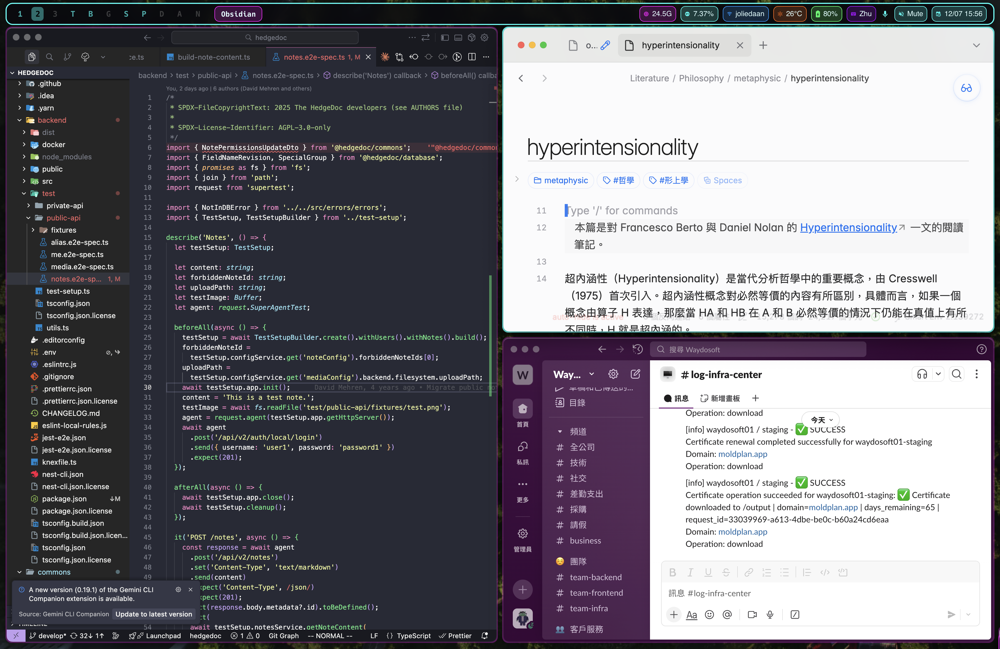

# macOS Dotfiles - Catppuccin Mocha

個人 macOS 設定檔，全部元件統一使用 Catppuccin Mocha 配色。

## 元件

- **[AeroSpace](https://github.com/nikitabobko/AeroSpace)** - 平鋪式視窗管理器
- **[SketchyBar](https://github.com/FelixKratz/SketchyBar)** - 自訂選單列
- **[JankyBorders](https://github.com/FelixKratz/JankyBorders)** - 視窗邊框
- **[Ghostty](https://ghostty.org/)** - 終端機，只當 herdr 的宿主 surface：啟動直接進 herdr，原生 tab/split 快捷鍵全部 unbind、關閉視窗裝飾，macOS 層級只會看到一個視窗；`` Ctrl+` `` 可在任何地方開關 quick terminal
- **[herdr](https://herdr.dev)** - Agent multiplexer，workspace/tab/pane 全部在單一 persistent session 裡管理（預設 `Ctrl+B` prefix）
- **[Hammerspoon](https://www.hammerspoon.org/)** - 目前沒有啟用中的功能，保留停用的 CMD+1~9 Ghostty 視窗切換器，供日後回到多視窗模式時使用
- **[tmux](https://github.com/tmux/tmux)** - 選用、需要時才手動開：`bin/tm [名稱]` 接到指定名稱的 session，`bin/zed-tmux` 讓 Zed 各專案有獨立的 persistent session
- **[LazyVim](https://www.lazyvim.org/)** - Neovim 設定，包含適合 CJK 的折行與拼字檢查、Yazi、Snacks Explorer（顯示 git 與 submodule 狀態）、Claude Code 整合、依目錄自動還原 session，以及 smart-splits 視窗導航

## 截圖



## 快速安裝

```bash
git clone https://github.com/wayne930242/dotfiles-macos.git ~/dotfiles-macos
cd ~/dotfiles-macos
./install.sh
```

安裝腳本會自動：
1. 安裝 Homebrew（如未安裝）
2. 安裝 AeroSpace、Hammerspoon、SketchyBar、JankyBorders、media-control、jq、Go、sketchybar-app-font、Neovim 與 Yazi
3. 備份現有設定至 `~/.dotfiles-backup/`
4. 建立 SketchyBar、JankyBorders、Neovim、Ghostty、AeroSpace、tmux、Hammerspoon 與 herdr 的 symlinks
5. 編譯 SketchyBar 的 net 輔助程式（`sketchybar/helpers/bin/net`）與桌布程式（`wallpaper/bin/wallgen`、`wallanim`，用 Xcode Command Line Tools 的 `swiftc`）
6. 啟動所有服務（包括 net feed 與桌布的 launch agent），並重新啟動 AeroSpace，確保 CLI 與 app server 使用相同版本

Ghostty、herdr、tmux 與字型不在腳本安裝範圍內，請見[前置需求](#前置需求)。

安裝完成後，先開一次 Hammerspoon、授予輔助使用權限，再從選單列圖示啟用「Launch at Login」。

### 其他指令

```bash
./install.sh install    # 安裝（預設）
./install.sh uninstall  # 移除 symlinks 並停止服務
./install.sh restore    # 從備份還原
./install.sh help       # 顯示說明
```

## 手動安裝

### 前置需求

```bash
brew install --cask nikitabobko/tap/aerospace
brew install --cask hammerspoon
brew tap FelixKratz/formulae
brew install sketchybar
brew install borders
brew install media-control  # 媒體小工具需要
brew install jq go          # SketchyBar 外掛需要 jq；net 輔助程式用 Go 編譯
brew install --cask font-sketchybar-app-font  # 工作區膠囊裡的 app 圖示
brew install --cask ghostty
brew install herdr
brew install tmux            # 選用，bin/tm 與 bin/zed-tmux 需要
brew install neovim yazi
brew install --cask font-iansui  # Ghostty 的台、客語缺字備援
```

Ghostty 另外需要 `MesloLGS NF`，SketchyBar 使用 `Hack Nerd Font Mono`。

### 設定

```bash
# 複製此專案
git clone https://github.com/wayne930242/dotfiles-macos.git ~/dotfiles-macos

# 建立 symlinks
ln -sf ~/dotfiles-macos/sketchybar ~/.config/sketchybar
ln -sf ~/dotfiles-macos/borders ~/.config/borders
ln -sf ~/dotfiles-macos/nvim ~/.config/nvim
ln -sf ~/dotfiles-macos/ghostty ~/.config/ghostty
ln -sf ~/dotfiles-macos/.aerospace.toml ~/.aerospace.toml
ln -sf ~/dotfiles-macos/.tmux.conf ~/.tmux.conf
ln -sf ~/dotfiles-macos/hammerspoon ~/.hammerspoon
mkdir -p ~/.config/herdr
ln -sf ~/dotfiles-macos/herdr/config.toml ~/.config/herdr/config.toml

# 啟動服務
brew services start sketchybar
brew services start borders
```

第一次啟動 Neovim 時，LazyVim 會自動啟動 `lazy.nvim`，並安裝 `nvim/lazy-lock.json` 鎖定的外掛版本。

## Zed 整合

`bin/zed-tmux` wrapper 讓 Zed terminal panel 接到專案專屬的 tmux session(命名為 `zed-<專案資料夾名>`),每個專案各自保留 shell 狀態,跨 Zed 重啟仍持續。

在 `~/.config/zed/settings.json` 加上:

```jsonc
"terminal": {
  "shell": {
    "with_arguments": {
      "program": "/Users/<你>/dotfiles-macos/bin/zed-tmux",
      "args": []
    }
  }
}
```

## 工作區

| 快捷鍵 | 工作區 | 用途 |
|--------|--------|------|
| `alt-1` | 1 | 終端機 (Ghostty) |
| `alt-2` ~ `alt-3` | 2–3 | 一般使用 |
| `alt-c` | C | 瀏覽器 (Chrome / Comet) |
| `alt-g` | G | 遊戲 / 休閒 |
| `alt-s` | S | 社交 (Discord, Telegram) |
| `alt-q` | Q | 專案 (Linear + Slack) |
| `alt-d` | D | OrbStack |
| `alt-a` | A | AI / Agents（Straw Net GUI） |
| `alt-z` | Z | Obsidian (筆記) |
| `alt-x` | X | Xcode（含 Simulator 與 Android Studio） |

有外接螢幕時，工作區 1–3 放在副螢幕；字母工作區固定在主螢幕。
`alt-enter` 開啟 Ghostty，`alt-shift-;` 進入 service mode（按 `esc` 重新載入設定）。

| 快捷鍵 | 動作 |
|--------|------|
| `alt-w` | 跳到下一個等你回覆的 agent（每按一次換下一個） |
| `alt-shift-w` | 開啟 Straw Net GUI |
| `alt-shift-b` | 把最新的副瀏覽器視窗（例如 agent 開的頁面）拉到目前的工作區並排；再按一次送回 G。沒有副視窗時改拉主 Chrome，再按一次送回 C |

## SketchyBar

**左側：** 模式指示（service mode）| 工作區（每個 app 一個圖示）

**瀏海右側：** 媒體（只在播放時出現）

**右側：** Straw Boss net | 狀態（音訊、電池、輸入法；點開可看 CPU／記憶體、溫度與網路）| 日曆

每一組都是同一種膠囊：同樣的底色、中性的邊框。圖示只有在回報狀態時才換顏色，例如有 agent 等你、電量低、麥克風靜音。狀態膠囊的齒輪依 CPU 使用率變色：30% 起黃色、60% 起橘色、85% 起紅色。

### Straw Boss net

這顆膠囊顯示 [Straw Boss](https://github.com/wayne930242/pi-straw-boss) 網裡等你回覆、出錯、執行中與已完成的 agent 數量；沒有 Straw Boss GUI 伺服器在跑時就隱藏。點開是整張網的樹狀選單：點一列會切到那個 agent 的 herdr pane，按住 shift 點則在 GUI 開它的通訊頁。點「Remote QR」會顯示一次性的配對 QR code（十分鐘內有效），用手機掃描就能透過 Tailscale 開啟 GUI；remote access 沒開的話會先打開。有 agent 等你時，焦點視窗的邊框會變成橘色。

`sketchybar/helpers/net` 是一支小型 Go 程式。它的 `feed` 以 launch agent `com.wayne930242.sketchybar-net` 常駐，訂閱 Straw Boss GUI 伺服器的事件串流（位址寫在 `~/.pi/agent/straw-boss/gui.json`），只重畫有變動的部分，記錄寫在 `~/Library/Logs/sketchybar-net.log`。herdr 的側欄預設收成零寬（`prefix+b` 可以打開），agent 清單就改看這顆膠囊。

想讓 GUI 成為 workspace A 裡的獨立視窗：先開啟 GUI（在 pi 裡輸入 `/boss gui`），再到 Chrome 選「投放、儲存及分享」>「將網頁安裝為應用程式」；AeroSpace 會把 `Straw Net` 這個 app 移到 A。

### 瀏海

內建螢幕的瀏海會蓋住底下的內容，而 SketchyBar 的左右項目不會避開它。`plugins/notch.sh` 在載入時與每次螢幕變更時量測瀏海（瀏海的點數寬度隨縮放改變：預設 1512 pt 時是 185 pt，1800 pt 時是 220 pt），設定 `notch_width`，並記下瀏海從哪裡開始；左側快碰到瀏海時，`plugins/aerospace.sh` 會減少每個工作區顯示的 app 圖示。

bar 本身是透明的，只畫膠囊。每個項目都是一個疊在 bar 視窗上方的視窗，而在 macOS 27，點 bar 空白處會把 bar 的視窗提到它們上面；SketchyBar 只在項目變動時重排視窗，所以 bar 若有底色，整排項目會被蓋住，直到下次 reload。

## 桌布

桌布由 `wallpaper/wallgen.swift` 產生：底圖是一張克蘇魯潛伏在黑暗裡的畫（`wallpaper/background.png`），左側以終端機輸出的樣子列出系統資訊、`~/projects` 近 26 週的 commit 熱度圖，以及 Straw Boss 今天的 session。launch agent `com.wayne930242.wallgen` 每小時在背景跑一次 `wallgen apply`（每次約 1.5 秒），其餘時間桌布就是一張靜態圖，不佔資源；記錄寫在 `~/Library/Logs/wallgen.log`。鎖定畫面沿用同一張圖。

```bash
wallpaper/bin/wallgen render --out /tmp/wall.png   # 只預覽，不設成桌布
wallpaper/bin/wallgen apply --style panels        # 另有 terminal（預設）、minimal
wallpaper/bin/wallgen apply --image none          # 不用底圖
```

移除後桌布會停在最後一張，要換回來請到「系統設定 > 桌布」。

另一個 launch agent `com.wayne930242.wallanim` 執行 `wallpaper/wallanim.swift`，在桌布上做幾個慢動畫：克蘇魯的眼睛呼吸發光、光點沿著圖上的資料流線往下流、掃描線滑過左側文字、游標閃爍，以及 Straw Boss 的即時數字（取代整點畫上去的舊數字，有 agent 在跑時「working」會呼吸）。動畫由 Core Animation 交給 WindowServer 合成，程式本身 CPU 是 0%；用電池、螢幕休眠，或桌面被視窗完全蓋住時會暫停。眼睛和資料流的位置記在 `wallpaper/background.json`，換底圖時要一起改；`wallgen apply` 會在桌布旁寫出 `layout.json` 給它用。

安裝時也會關掉桌面小工具（`StandardHideWidgets`），不然隔著半透明視窗看到桌布時，小工具會浮在上面。下次登入後生效；uninstall 與 restore 會還原這個設定。

Ghostty 在桌布上半透明（opacity 0.75、blur 40；macOS 上改了要完全結束 Ghostty 再開才生效）。herdr 的側欄與 Neovim 會自己畫背景色，`background-opacity-cells` 讓它們也一起透。

## 主題配色

所有元件都使用 [Catppuccin Mocha](https://catppuccin.com/palette)：Ghostty（`Catppuccin Mocha`）、herdr（`catppuccin`）、LazyVim（`catppuccin-mocha`）、SketchyBar 與 JankyBorders。

SketchyBar 與 JankyBorders 的顏色來自 `themes/<名稱>.sh`，切換時改 `sketchybar/colors.sh` 與 `borders/bordersrc` 裡的 `THEME`。原本的電馭叛客配色封存在兩個目錄下的 `themes/cyberpunk.sh`。

## 測試

`tests/` 放的是 AeroSpace 設定、安裝腳本與主題設定的 shell contract 檢查：

```bash
for t in tests/*.sh; do bash "$t"; done
```

net 輔助程式有 Go 單元測試：

```bash
(cd sketchybar/helpers/net && go test ./...)
```

## 授權

MIT
